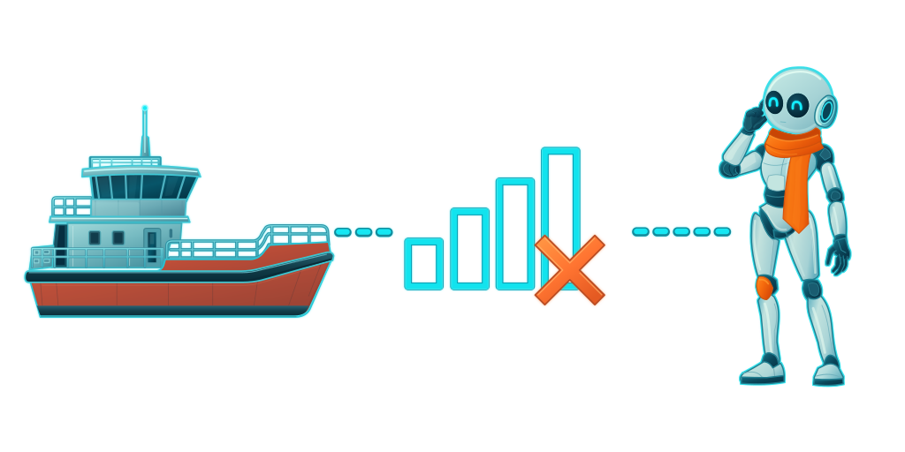

# PaintManager

PaintManager is a Lua mod for **The Last Caretaker**. See which paints you own, learn recipes from the cans you have collected, and save paint schemes for your ship and character.

**[Download the latest mod ZIP](https://github.com/umanamente/tlc-paint-manager-mod/releases/latest)** · [Installation guide](docs/gamers/installation.md)

## First use

1. Install a compatible UE4SS loader and extract the versioned PaintManager ZIP into the game's `Voyage/Binaries/Win64/` directory. The ZIP includes the `ue4ss/Mods/PaintManager/` folder. [Installation and updates](docs/gamers/installation.md)
2. Load a save and stand within **35 m** of your ship. Leave vehicle controls and close any menus, then press **Ctrl+Alt+F10**. You can also use **Open PaintManager** in the cockpit paint editor.
3. Open **Can Learn** to find unlearned recipes for which you have at least four matching cans in your backpack and nearby player storage boxes. Click **Learn** to add the recipe and keep the cans.

## What you can do

| Task | Where to start |
| --- | --- |
| Find a paint | Browse **Learned**, **Can Learn** or **Need Cans**. Search by the paint's in-game name. |
| Fill your backpack | Select a color and top it up to a chosen total. You can also gather all colors that fit and return borrowed paint to its original boxes. |
| Keep a paint scheme | Open **Presets** and choose **Ship** or **Character**. Save the current layout, preview another one or apply it with physical cans. |
| Adjust the interface | Open **Settings** to choose a ship radius, backpack target or deposit options. PaintManager follows the game language by default. You can also choose from [14 interface languages](docs/gamers/guide.md#language). |

*PaintManager displays this illustration when the player is outside the selected ship's connection radius.*

## Compatibility

The reference environment is the Windows Steam build **25982825** of The Last Caretaker and UE4SS revision **527a483b**. Certain gameplay actions require that build. Python is needed only for development. [Installation and compatibility](docs/gamers/installation.md)

## Documentation

- For players, see [using PaintManager](docs/gamers/guide.md) and [troubleshooting](docs/gamers/troubleshooting.md).
- For contributors, see [getting started](CONTRIBUTING.md), the [code map and architecture decisions](docs/maintainers/architecture.md), [testing](docs/maintainers/testing.md) and [releases](docs/maintainers/releases.md).
- For AI agents, see the [project instructions](AGENTS.md) and [working guide](docs/ai/working-guide.md).

See the [changelog](CHANGELOG.md) for the release contents. PaintManager code is distributed under the [MIT license](LICENSE).
