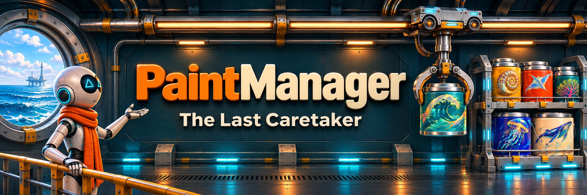

# PaintManager for The Last Caretaker

Use your paint collection to learn recipes, move cans between your backpack and ship storage, and save paint schemes for the ship and character.

Install a compatible UE4SS loader, then extract the PaintManager ZIP into the game's `Voyage/Binaries/Win64/` directory. In a loaded save, stand near your ship and press **Ctrl+Alt+F10** from gameplay. Press **Escape** to close the window.

- [Installation, updates and removal](installation.md)
- [Controls, paint transfers and presets](guide.md)
- [Troubleshooting](troubleshooting.md)
